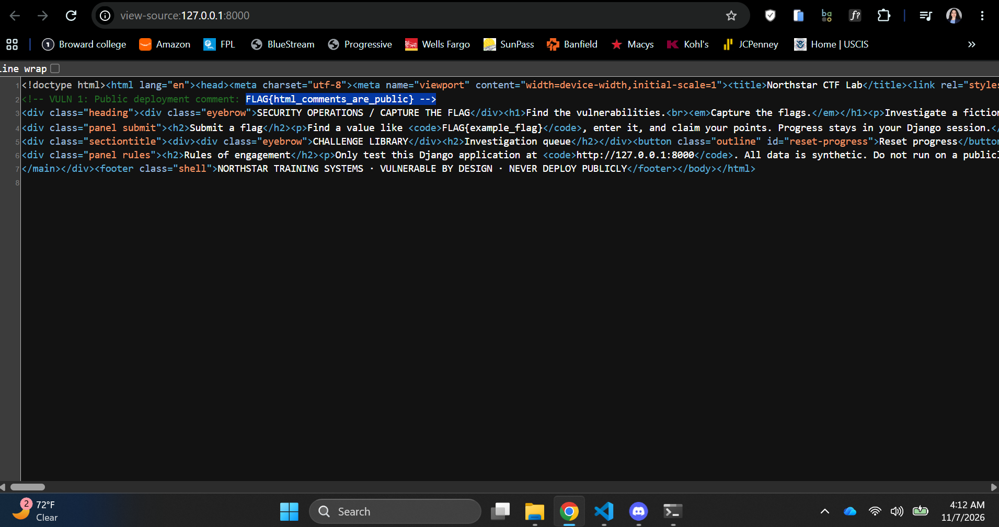
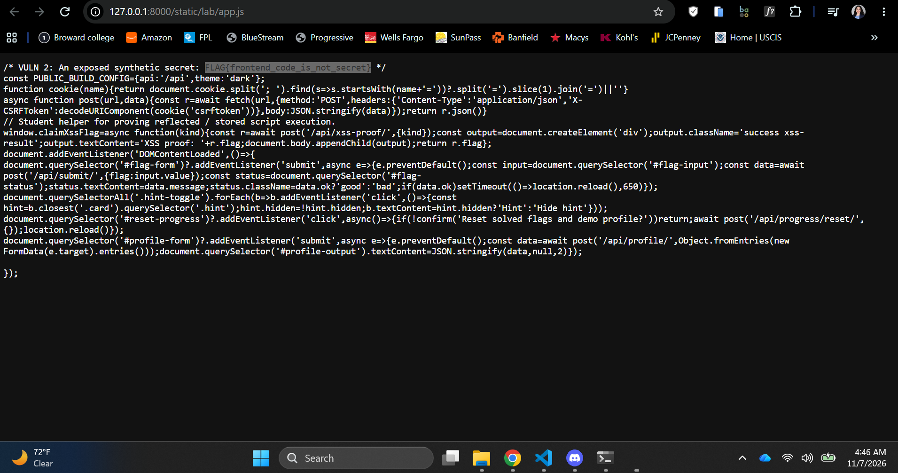
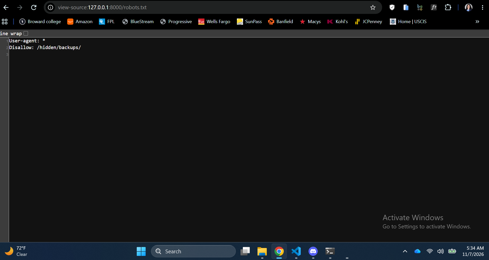
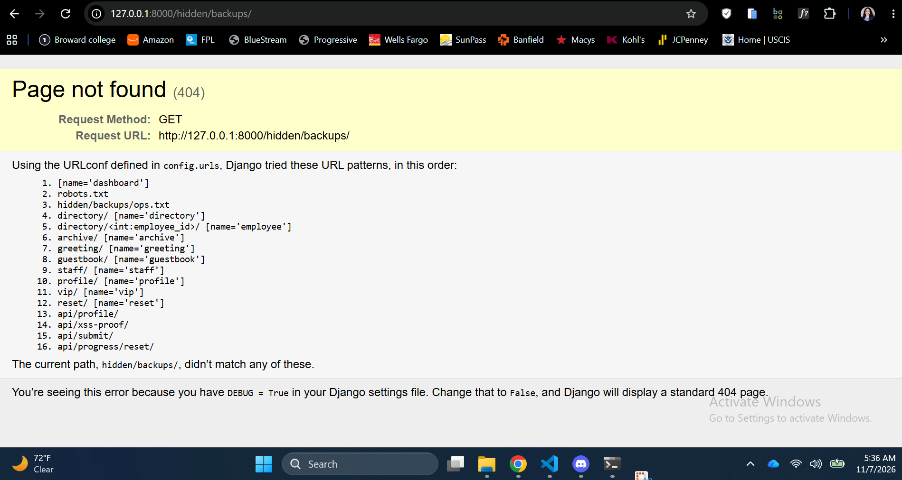
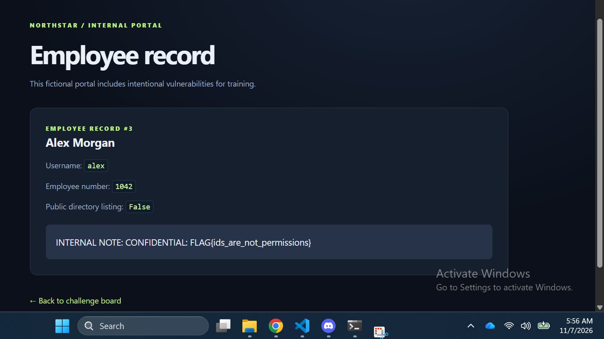
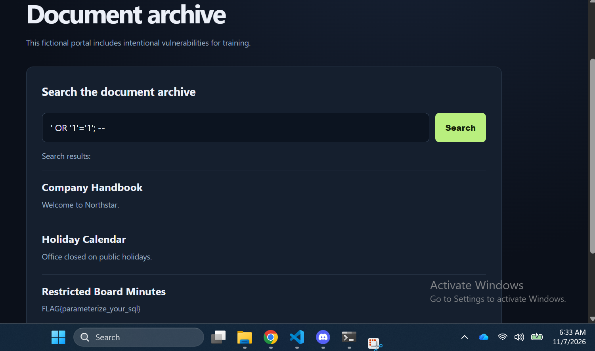

# Northstar CTF — Investigation report

**Student:** Albany Tafuro  **Date:** 11/07/2026

For each of the ten exercises record the following:

## Challenge #1 — HTML Comments

**Difficulty:** Easy  **Points:** 50

**1. Vulnerable feature / endpoint:** 
The flag was exposed in an HTML comment within the homepage source code. 

URL: `view-source:http://127.0.0.1:8000/`

**2. Reconnaissance and tools used:** 
Browser Developer Tools and the View Page Source feature.

**3. Steps to reproduce (include URL, HTTP method, input or browser-console command):**

1. Navigate to `http://127.0.0.1:8000/` using a web browser.
2. Right-click anywhere on the homepage and select "View Page Source."
3. Examine the HTML source code for comments containing sensitive information.
4. Locate the exposed flag within an HTML comment.

**4. Evidence (what happened, screenshot, response or console output):** 

The homepage source code contained an HTML comment exposing the challenge flag.

**5. Flag captured:** Public deployment comment: 

`FLAG{html_comments_are_public}`

**6. Root cause (what made this possible):** 

The developer included sensitive information in an HTML comment. Although HTML comments are not displayed on the rendered webpage, they remain accessible to anyone inspecting the page's source code.

**7. Potential real-world impact:**

In a real-world application, exposing sensitive information through HTML comments could allow attackers to discover internal application details, hidden endpoints, or accidentally disclosed credentials. This information could assist attackers in identifying additional vulnerabilities or gaining unauthorized access.

**8. How a developer should prevent it:** 

Developers should never include sensitive information, such as passwords, API keys, authentication tokens, or internal configuration details, in HTML comments or other client-side code. Sensitive information should remain on the server and should never be included in the HTML response sent to the browser. 

---

## Challenge #2 — JavaScript Exposure

**Difficulty:** Easy  **Points:** 50 

**1. Vulnerable feature / endpoint:** 

The flag was exposed in a JavaScript file (`app.js`) that is publicly accessible through the application's static files.

URL: `http://127.0.0.1:8000/static/lab/app.js`

**2. Reconnaissance and tools used:** 

Browser Developer Tools and the View Page Source feature.

**3. Steps to reproduce (include URL, HTTP method, input or browser-console command):** 

1. Navigate to `http://127.0.0.1:8000/` using a web browser.
2. Right-click anywhere on the homepage and select "View Page Source."
3. Locate the reference to the `app.js` JavaScript file.
4. Click the file's URL to inspect its contents.
5. Examine the JavaScript source code and locate the exposed flag within a comment.

**4. Evidence (what happened, screenshot, response or console output):** 

The publicly accessible JavaScript file contained a comment exposing the challenge flag.

**5. Flag captured:** An exposed synthetic secret: 

`FLAG{frontend_code_is_not_secret}`

**6. Root cause (what made this possible):** 

The developer placed a secret flag inside a JavaScript comment. Because JavaScript files are downloaded and executed by the user's browser, their source code is publicly accessible. Any sensitive information included in these files can be discovered by inspecting their contents.

**7. Potential real-world impact:** 

In a real-world application, exposing sensitive information through JavaScript files could allow attackers to discover API keys, authentication tokens, internal endpoints, or application configuration details.

**8. How a developer should prevent it:** 

Developers should never store sensitive information, including passwords, private API keys, authentication secrets, or confidential configuration values, in client-side JavaScript files.

Sensitive operations and secrets should be handled securely on the server. Developers should also review JavaScript files before deployment to identify and remove accidentally exposed information.

---

## Challenge #3 — Information disclosure

**Difficulty:** Easy  **Points:** 50

**1. Vulnerable feature / endpoint:** 

A sensitive backup file was exposed through a publicly accessible URL. The location of this file was discovered using information from `robots.txt` and a Django debugging page.

URL: `http://127.0.0.1:8000/hidden/backups/ops.txt`

**2. Reconnaissance and tools used:** View page source, 404 page url's

**3. Steps to reproduce (include URL, HTTP method, input or browser-console command):**

Web browser, `robots.txt`, URL inspection, and Django's debug-enabled 404 page.

**3. Steps to reproduce (include URL, HTTP method, input or browser-console command):**  
1. Navigate to `http://127.0.0.1:8000/robots.txt`.
2. Examine the file and identify the directory path `/hidden/backups/`.
3. Navigate to `http://127.0.0.1:8000/hidden/backups/`.
4. Observe the Django 404 debugging page, which exposes additional application URL patterns.
5. Identify the `ops.txt` file referenced in the debugging information.
6. Navigate to `http://127.0.0.1:8000/hidden/backups/ops.txt`.
7. Examine the exposed file and capture the flag.

HTTP Method: `GET`

**4. Evidence (what happened, screenshot, response or console output):**

The `robots.txt` file revealed a hidden directory. Navigating to that directory produced a debug-enabled 404 page that provided additional information, allowing the sensitive file to be located.

**5. Flag captured:** 

`FLAG{robots_is_not_access_control}`

**6. Root cause (what made this possible):**  

The application relied on publicly accessible paths to expose information about a sensitive directory. The `robots.txt` file disclosed the directory's location, while Django's enabled debugging mode revealed additional application details.

**7. Potential real-world impact:**  

In a real-world application, this vulnerability could allow attackers to discover sensitive directories, backup files, internal configurations, or application information.

Exposing Django's debugging information could also help attackers understand the application's internal structure and identify additional vulnerabilities. If confidential files are publicly accessible, attackers could retrieve information that was never intended for external users.

**8. How a developer should prevent it:**  

Developers should never rely on `robots.txt` or hidden URLs to protect sensitive information. Sensitive files should be stored outside publicly accessible directories and protected through server-side authentication and authorization controls. Additionally, Django's `DEBUG` setting must be set to `False` in production environments to prevent detailed debugging information from being exposed to users.

---

## Challenge #4 —  IDOR

**Difficulty:** Medium  **Points:** 100

**1. Vulnerable feature / endpoint:**  

The employee directory allowed access to an employee record by modifying the numerical identifier in the URL.

URL: `http://127.0.0.1:8000/directory/3/`

**2. Reconnaissance and tools used:**  

Web browser and manual URL manipulation.

**3. Steps to reproduce (include URL, HTTP method, input or browser-console command):**  
1. Navigate to the application's employee directory.
2. Examine the URL structure used to display individual employee records.
3. Notice that employee records are identified using numerical values in the URL.
4. Modify the numerical identifier to access another employee record.
5. Navigate to `http://127.0.0.1:8000/directory/3/`.
6. Observe that an employee record not displayed in the original directory is accessible.
7. Locate the challenge flag within the exposed record.

HTTP Method: `GET`

**4. Evidence (what happened, screenshot, response or console output):**  

Changing the numerical identifier in the URL allowed access to an additional employee record that was not displayed in the original directory.

**5. Flag captured:**  

`FLAG{ids_are_not_permissions}`

**6. Root cause (what made this possible):** 

The vulnerability was caused by missing or insufficient object-level authorization checks.

**7. Potential real-world impact:**  
In a real-world application, an attacker could manipulate URL identifiers to access employee information, customer records, financial documents, or other resources belonging to different users.
This vulnerability could result in unauthorized data disclosure, privacy violations, and potential identity theft.

**8. How a developer should prevent it:**  

Developers should implement server-side authorization checks for every request involving protected records. Before returning an employee record, the application should verify that the requesting user has permission to access that specific resource.

---

## Challenge #5 — SQL Injection

**Difficulty:** Medium  **Points:** 100

## Challenge #5 — SQL Injection

**Difficulty:** Medium  **Points:** 100

**1. Vulnerable feature / endpoint:**  

The document archive's search functionality was vulnerable to SQL injection through its `q` query parameter.

URL: `http://127.0.0.1:8000/archive/`

**2. Reconnaissance and tools used:**  

Web browser, Google Search for SQL injection examples, and manual testing of the document archive's search field.

**3. Steps to reproduce (include URL, HTTP method, input or browser-console command):**

1. Navigate to `http://127.0.0.1:8000/archive/`.
2. Identify the search field used to retrieve archived documents.
3. Research common SQL injection techniques and example payloads.
4. Enter the following SQL injection payload into the search field:

   `' OR '1'='1'; --`

5. Submit the search request.
6. Observe how the application processes the injected SQL expression.
7. Examine the returned results and locate the exposed challenge flag.

**4. Evidence (what happened, screenshot, response or console output):**  
Submitting the SQL injection payload caused the application to return information that should not have been accessible through a normal document search.

**5. Flag captured:**  

`FLAG{parameterize_your_sql}`

**6. Root cause (what made this possible):**  

The expression `'1'='1'` evaluates to true, potentially causing the query to return records that would normally be excluded. The `--` sequence can comment out the remaining portion of a SQL statement, depending on the database and query structure.

**7. Potential real-world impact:** 

In a real-world application, SQL injection could allow attackers to retrieve unauthorized database records, bypass application restrictions, or manipulate stored information. Depending on the database permissions and the vulnerability's severity, an attacker could potentially modify or delete records, expose sensitive customer information, or compromise the application's database.

**8. How a developer should prevent it:**  

Developers should use parameterized queries instead of constructing SQL statements by directly combining user input with SQL code. When raw SQL is necessary, developers should use parameter placeholders and supply user input as separate parameters rather than inserting it directly into a SQL string. Input validation and database permissions can provide additional protection, but they should not replace parameterized queries.

---

## Challenge #6 — Reflected XSS

**Difficulty:** Medium  **Points:** Medium

**1. Vulnerable feature / endpoint:**

**2. Reconnaissance and tools used:**

**3. Steps to reproduce (include URL, HTTP method, input or browser-console command):**

**4. Evidence (what happened, screenshot, response or console output):**

**5. Flag captured:**

**6. Root cause (what made this possible):**

**7. Potential real-world impact:**

**8. How a developer should prevent it:**

---

## Challenge #___ — ______________________

**Difficulty:** ______  **Points:** ______

**1. Vulnerable feature / endpoint:**

**2. Reconnaissance and tools used:**

**3. Steps to reproduce (include URL, HTTP method, input or browser-console command):**

**4. Evidence (what happened, screenshot, response or console output):**

**5. Flag captured:**

**6. Root cause (what made this possible):**

**7. Potential real-world impact:**

**8. How a developer should prevent it:**

---

## Challenge #___ — ______________________

**Difficulty:** ______  **Points:** ______

**1. Vulnerable feature / endpoint:**

**2. Reconnaissance and tools used:**

**3. Steps to reproduce (include URL, HTTP method, input or browser-console command):**

**4. Evidence (what happened, screenshot, response or console output):**

**5. Flag captured:**

**6. Root cause (what made this possible):**

**7. Potential real-world impact:**

**8. How a developer should prevent it:**

---

## Challenge #___ — ______________________

**Difficulty:** ______  **Points:** ______

**1. Vulnerable feature / endpoint:**

**2. Reconnaissance and tools used:**

**3. Steps to reproduce (include URL, HTTP method, input or browser-console command):**

**4. Evidence (what happened, screenshot, response or console output):**

**5. Flag captured:**

**6. Root cause (what made this possible):**

**7. Potential real-world impact:**

**8. How a developer should prevent it:**

---

## Challenge #___ — ______________________

**Difficulty:** ______  **Points:** ______

**1. Vulnerable feature / endpoint:**

**2. Reconnaissance and tools used:**

**3. Steps to reproduce (include URL, HTTP method, input or browser-console command):**

**4. Evidence (what happened, screenshot, response or console output):**

**5. Flag captured:**

**6. Root cause (what made this possible):**

**7. Potential real-world impact:**

**8. How a developer should prevent it:**

---

## Final reflection

Which vulnerabilities were caused by trusting client input? Which were caused by accidentally exposing data? What defensive controls would you prioritize?
