# Northstar CTF — Investigation report

**Student:** Gustavo Rivero  **Date:** 11/07/2026

For each of the ten exercises record the following:

## Challenge #03 — Information disclosure

**Difficulty:** Easy **Points:** 50

**1. Vulnerable feature / endpoint:**

http://127.0.0.1:8000/hidden/backups/ops.txt

**2. Reconnaissance and tools used:**

Robots.txt & Debug mode

**3. Steps to reproduce (include URL, HTTP method, input or browser-console command):**

Based on the description of the challenge, I went to the robots.txt page. I have used this to 
tell robot crawlers where I allow them to search through.

This robot.txt file had one dissallowed link at "/hidden/backups/". I appended this path to the 
URL base and it was actually a broken link path. Since this website has debug mode on, I saw all
possible URL paths. One in particular was completing the "/hidden/backups/" path by adding 
"ops.txt". Using that file path, I found the flag.

**4. Evidence (what happened, screenshot, response or console output):**

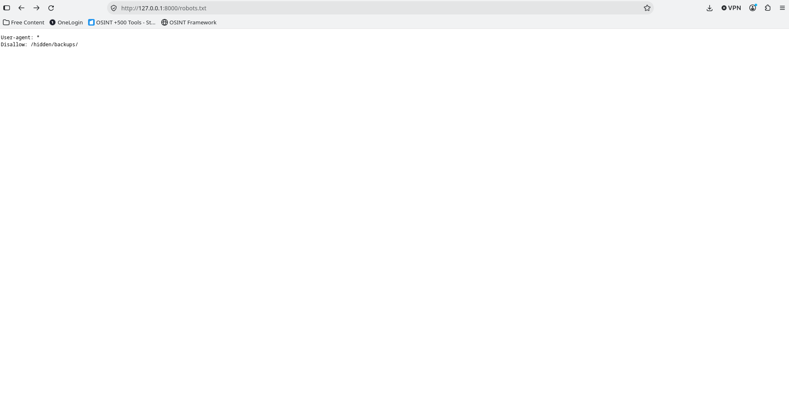

**5. Flag captured:**

`FLAG{robots_is_not_access_control}`

**6. Root cause (what made this possible):**

First the Robots.txt exposed a hidden partial path; but ultimately got solved because
the developer left the website on Debug mode during production.

**7. Potential real-world impact:**

All URLs can be exposed; which can lead threat actors into the dangerous areas

**8. How a developer should prevent it:**

Ensure you go over your deployment checklist and NEVER leave debug on in a production website

---

## Challenge #06 — Reflected XSS

**Difficulty:** medium  **Points:** 150

**1. Vulnerable feature / endpoint:**

http://127.0.0.1:8000/greeting/?name=%3Cscript%3EclaimXssFlag%28%22reflected%22%29%3C%2Fscript%3E

**2. Reconnaissance and tools used:**

Cross Side Scripting

**3. Steps to reproduce (include URL, HTTP method, input or browser-console command):**

enter a script element with the claimXssFlag("reflected") JavaScript command into the form

**4. Evidence (what happened, screenshot, response or console output):**

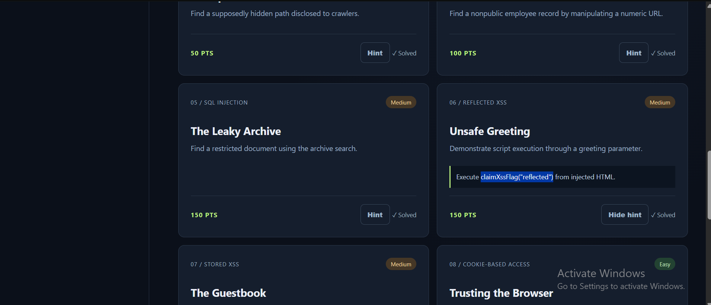
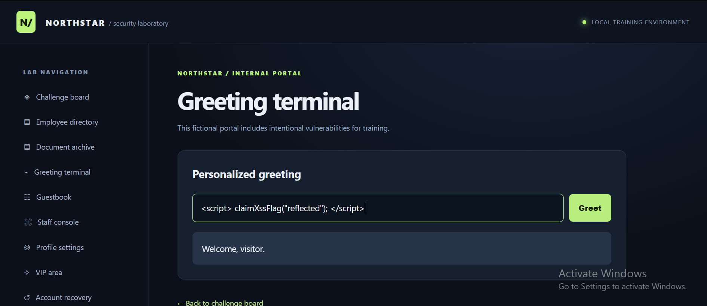
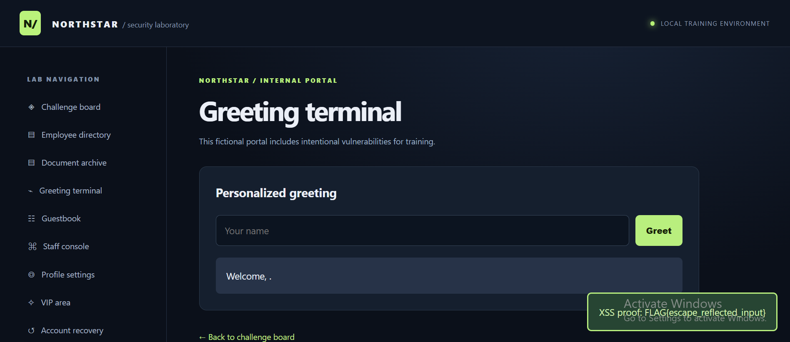

**5. Flag captured:**

`FLAG{escape_reflected_input}`

**6. Root cause (what made this possible):**

Not sanitizing the form input from users allowed me to
execute a script with custom JS

**7. Potential real-world impact:**

If we had this vulnerability on our production website,
we would be granting an open door to our entire website.
An attacker can execute their own code, change content
on the website and much more.

**8. How a developer should prevent it:**

Always validate and sanitize data to prevent scripting
issues. In the Django Framework specifically, all forms
should be accompanied with the  to prevent

---

## Challenge #08 — Cookie-based access

**Difficulty:** easy  **Points:** 100

**1. Vulnerable feature / endpoint:**

http://127.0.0.1:8000/staff/

**2. Reconnaissance and tools used:**

Inspect Panel Storage and challenge hint

**3. Steps to reproduce (include URL, HTTP method, input or browser-console command):**

Created a new cookie on the browser to set my user role as 'admin'

**4. Evidence (what happened, screenshot, response or console output):**

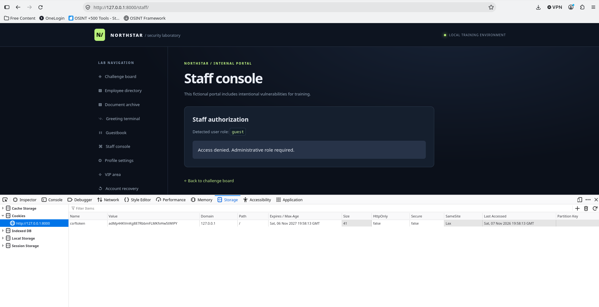
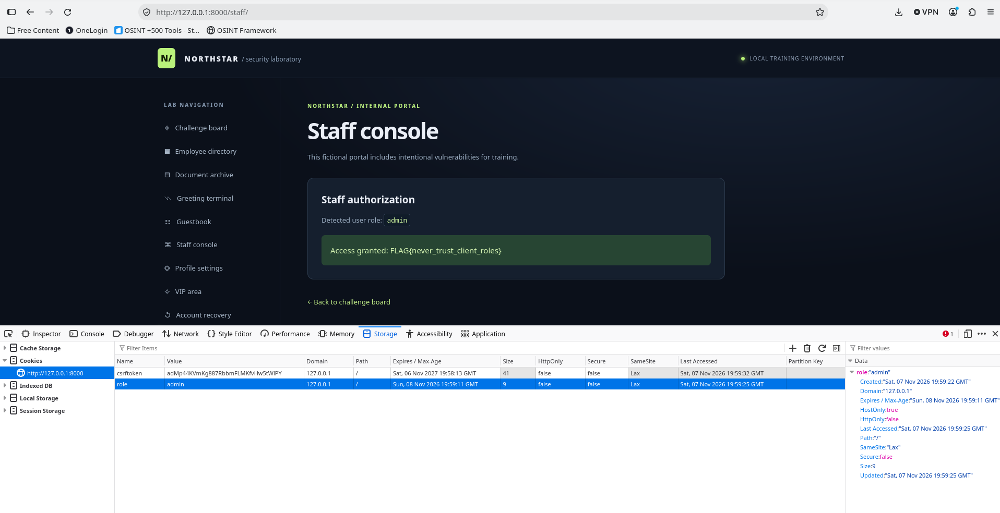

**5. Flag captured:**

`FLAG{never_trust_client_roles}`

**6. Root cause (what made this possible):**

This was possible because the web site used cookies to set a user's
role type and permission. Cookies can be created, modified, and deleted.

**7. Potential real-world impact:**

With this vulnerability, permission controls mean nothing. Any potential
threat actor can manipulate the browser cookies to gain access to secure
sections of the website.

**8. How a developer should prevent it:**

Always check for user role type or permissions through
the backend and never save sensitive secrets through
cookies. In Django, we can check permissions in the
backend through the views, preventing unauthorized
access to our secure areas.

---

## Challenge #09 — Mass assignment

**Difficulty:** hard  **Points:** 200

**1. Vulnerable feature / endpoint:**

http://127.0.0.1:8000/vip/

**2. Reconnaissance and tools used:**

Inspect Panel Network tab

**3. Steps to reproduce (include URL, HTTP method, input or browser-console command):**

Start by submitting the profile settings form while having inspect panel network tab on.
This will capture a POST request with the profile settings in a json structure. The json
response also includes the hidden `is_vip` data key. 

Using the inspect panel, we can edit the response and resend it. We modified the destination
url based on the form's indication to target the VIP area to target `/vip` instead of the default
`/api/profile` url. We also included the `is_vip` flag set to `true` on the request body.

Once the modified request and posted through the button, we simply navigated to the VIP area, where the flag
was waiting for us.

**4. Evidence (what happened, screenshot, response or console output):**

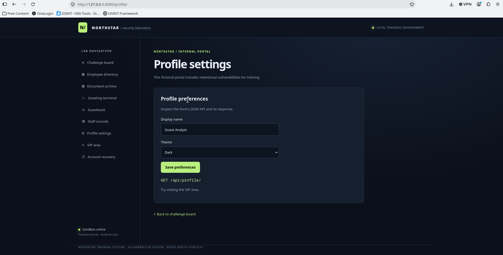
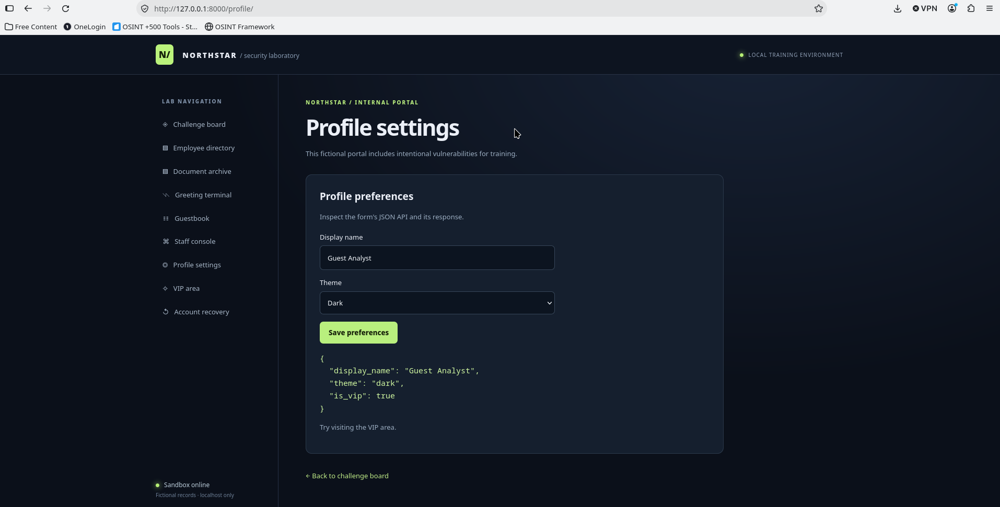
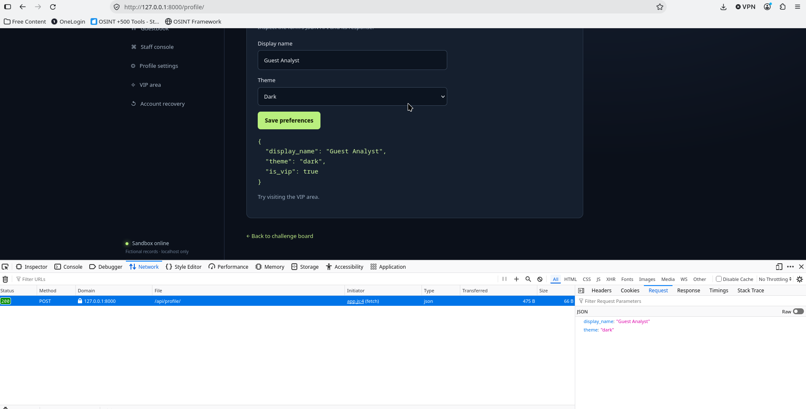
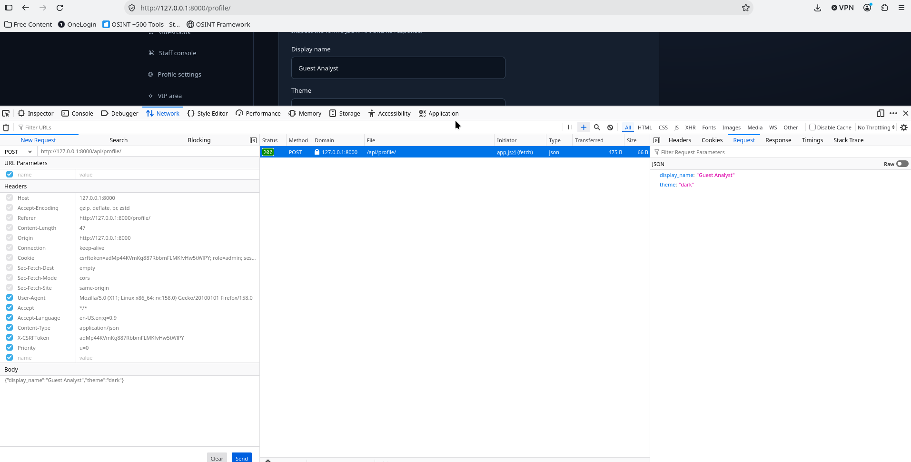
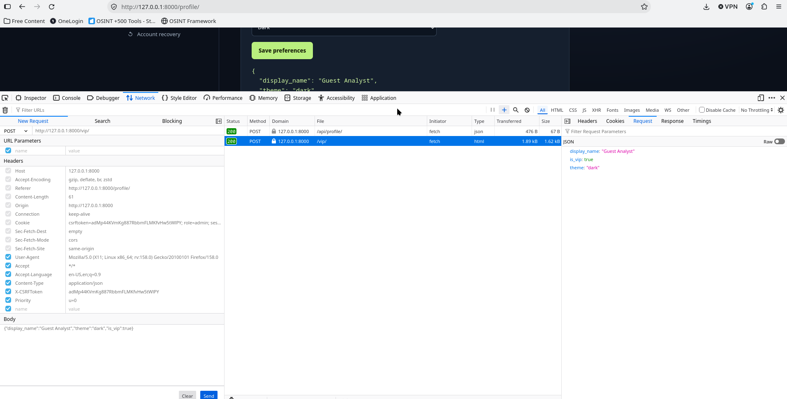
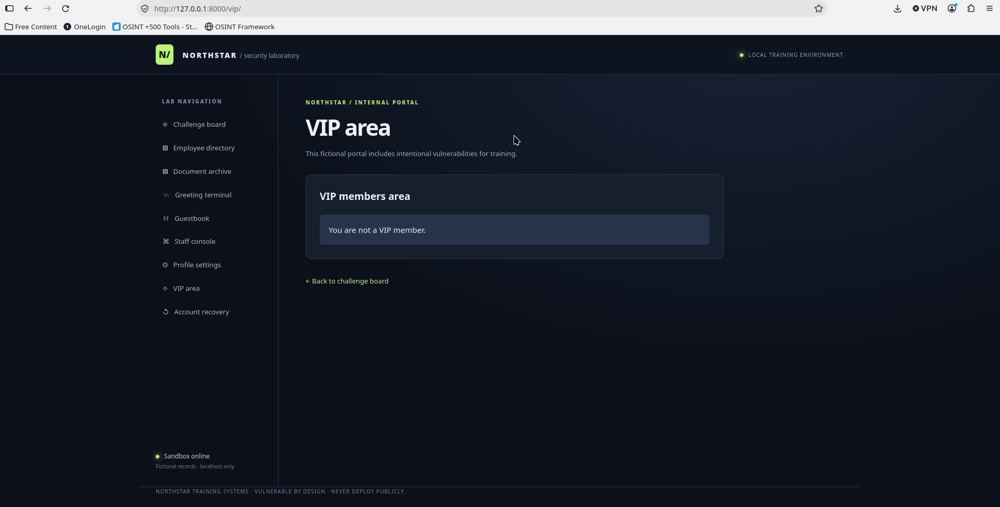
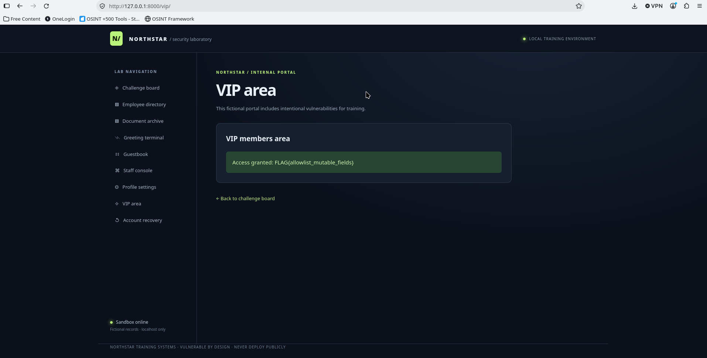

**5. Flag captured:**

`FLAG{allowlist_mutable_fields}`

**6. Root cause (what made this possible):**

This was possible because the web site is allowing and accepting modified
JSON requests.

**7. Potential real-world impact:**

With this vulnerability, a threat actor can bipass permission checks. This
makes access control uneffective and can expose data or controls to unauthorized
users.

**8. How a developer should prevent it:**

I'm actually not entirely sure how to prevent this attack. I do know
that an API typically has some kind of authentication layer, like a secret
key, to identify the user/agent making the request and determine if they 
are authorized to make a request.
---

## Final reflection

What I gathered from this exercise is that it can be extremely easy to have a gap
within your own app. The slightest mistake or forgotten configuration can expose
your users data and the entire entegrity of your web app. 

We must constantly audit and test our own security to find these vulnerabilities
before a threat actor does.
