# Northstar CTF — Investigation report

**Student:** Thomas Prudent  **Date:** 11/07/2026

For each of the ten exercises record the following:

## Challenge #2 — JavaScript exposure

**Difficulty:** easy  **Points:** 50

**1. Vulnerable feature / endpoint:**

view-source:http://127.0.0.1:8000/static/lab/app.js

**2. Reconnaissance and tools used:**

Inspect Element

**3. Steps to reproduce (include URL, HTTP method, input or browser-console command):**

View page source, then open /static/lab/app.js, and copy the vulnerabilty is found there

**4. Evidence (what happened, screenshot, response or console output):**

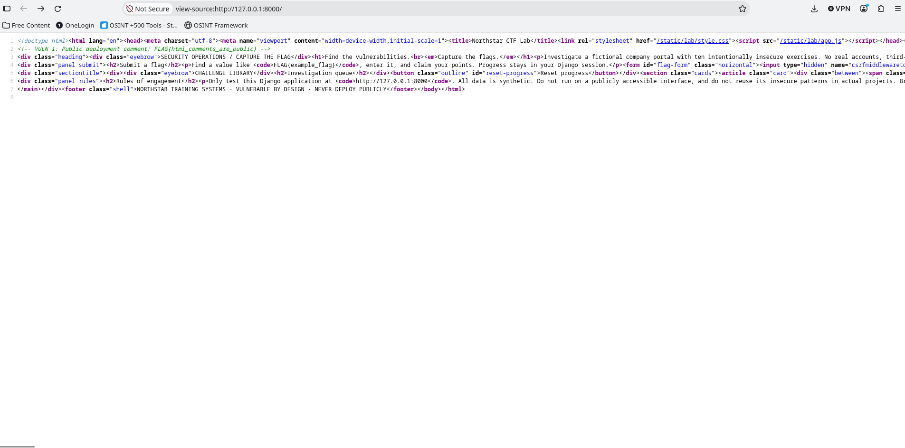
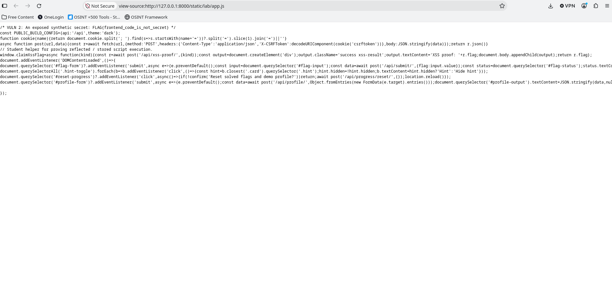

**5. Flag captured:**

`FLAG{frontend_code_is_not_secret}`

**6. Root cause (what made this possible):**

Open access to project files via the source code

**7. Potential real-world impact:**

A hacker could steal code to potentially get into project systems

**8. How a developer should prevent it:**

Javascript is public source and having private information commented in is not good practice

---

## Challenge 3 # — A Helpful Crawler

**Difficulty:** easy **Points:** 50

**1. Vulnerable feature / endpoint:**

view-source:http://127.0.0.1:8000/robots.txt

**2. Reconnaissance and tools used:**

Inspect element and URL

**3. Steps to reproduce (include URL, HTTP method, input or browser-console command):**

insert /robts.txt into inspect element, insert /hidden/backups into homepage url, insert ops.txt into page url as well.

**4. Evidence (what happened, screenshot, response or console output):**

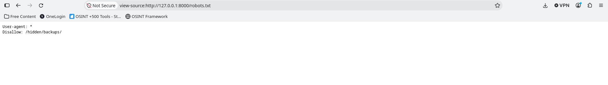
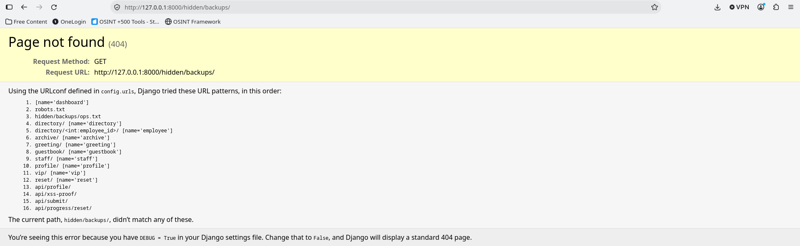
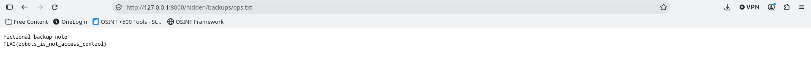

**5. Flag captured:**

`FLAG{robots_is_not_access_control}`

**6. Root cause (what made this possible):**

Debugging Error 404 had not been deactivated

**7. Potential real-world impact:**

A hacker could access hidden files or data after seeing the error screen

**8. How a developer should prevent it:**

Set debug to false when releasing the website

---

## Challenge 4 # — Someone Else’s Profile

**Difficulty:** medium **Points:** 100

**1. Vulnerable feature / endpoint:**

http://127.0.0.1:8000/directory/3/

**2. Reconnaissance and tools used:**

Changing User id in URL

**3. Steps to reproduce (include URL, HTTP method, input or browser-console command):**

Follow the pattern of user id's being 1 and 2, and insert 3 in place of user ID to find another user

**4. Evidence (what happened, screenshot, response or console output):**

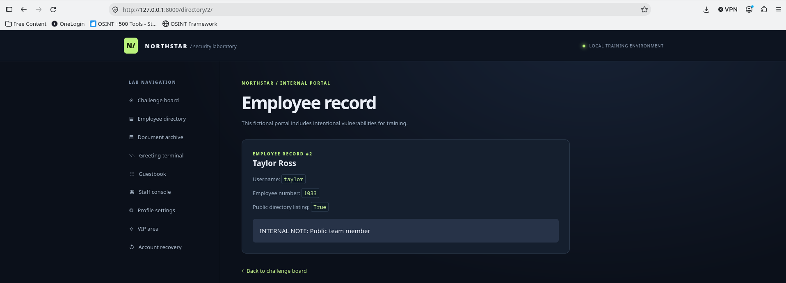
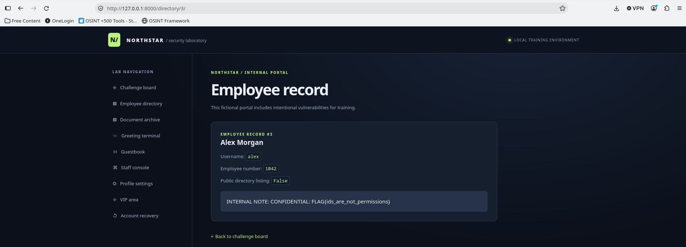

**5. Flag captured:**

`FLAG{ids_are_not_permissions}`

**6. Root cause (what made this possible):**

Having user ids be stored in simple numerical patterns makes finding users simple.

**7. Potential real-world impact:**

A hacker could access hidden users and their logins

**8. How a developer should prevent it:**

use a unique identifier when crreating user id's

---

## Challenge 5 # — The Leaky Archive

**Difficulty:** medium **Points:** 150

**1. Vulnerable feature / endpoint:**

http://127.0.0.1:8000/archive/?q=%27+OR+%271%27+%3D+%271%27%3B++--

**2. Reconnaissance and tools used:**

SQL injection

**3. Steps to reproduce (include URL, HTTP method, input or browser-console command):**

Close the previous line with ', then insert and or statement that will be true, close the line (;), and comment out the rest (--)

**4. Evidence (what happened, screenshot, response or console output):**

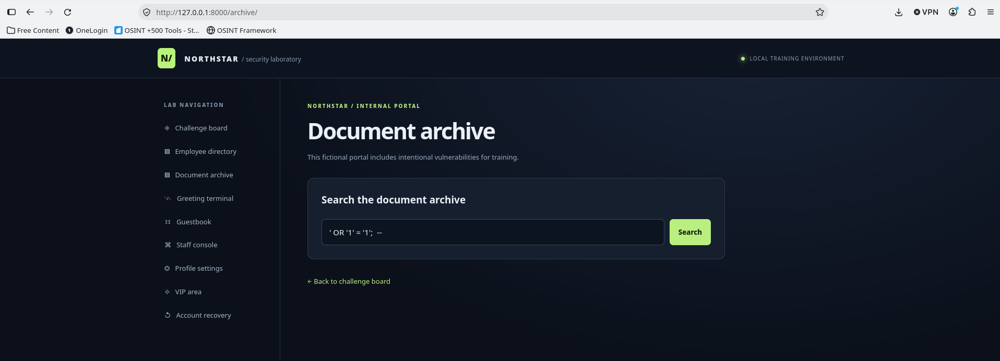
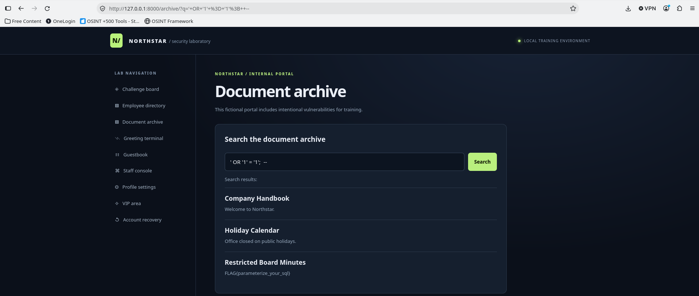

**5. Flag captured:**

`FLAG{parameterize_your_sql}`

**6. Root cause (what made this possible):**

The user is able to insert code into the box and have it run as normal; This code, as seen here, can be malicious.

**7. Potential real-world impact:**

A hacker could use code to access files that are inaccessible to users.

**8. How a developer should prevent it:**

Validate user input to prevent users from having their code run on the program.

--- 

## Challenge 6 # — Unsafe Greeting

**Difficulty:** medium **Points:** 150

**1. Vulnerable feature / endpoint:**

http://127.0.0.1:8000/greeting/?name=%3Cscript%3EclaimXssFlag%28%22reflected%22%29%3B%3C%2Fscript%3E

**2. Reconnaissance and tools used:**

XSS(Cross Site Scripting)

**3. Steps to reproduce (include URL, HTTP method, input or browser-console command):**

 use script to send out the cross site script, and then end it with a semi-colon

**4. Evidence (what happened, screenshot, response or console output):**

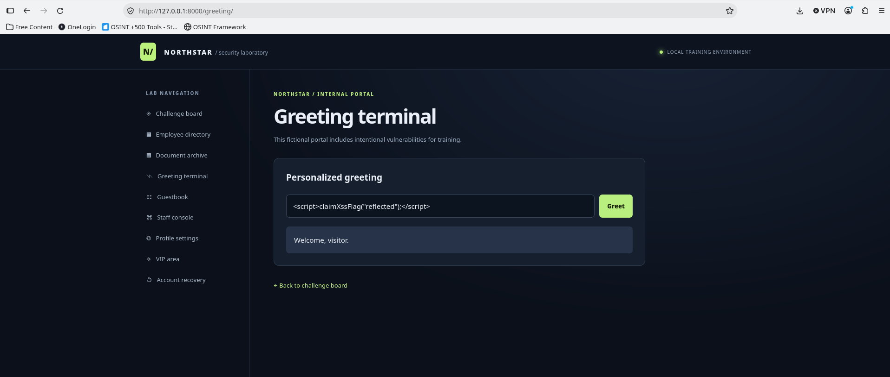
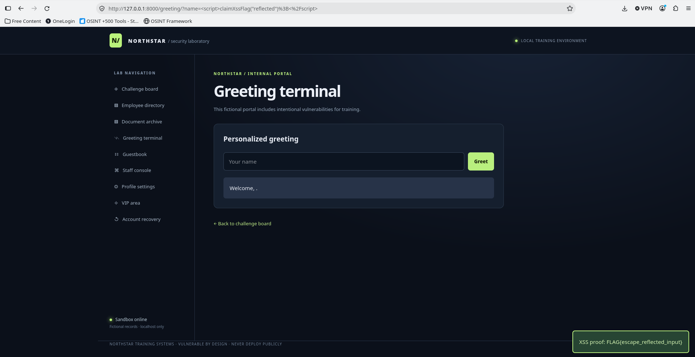

**5. Flag captured:**

 `FLAG{escape_reflected_input}`

**6. Root cause (what made this possible):**

The user is able to insert scripts into the terminal and potentially execute malicous code

**7. Potential real-world impact:**

A hacker could use a script to pose a security risk

**8. How a developer should prevent it:**

Validate user input to prevent scripts from being able to run

---

## Challenge 7 # — The Guestbook

**Difficulty:** medium **Points:** 150

**1. Vulnerable feature / endpoint:**

http://127.0.0.1:8000/guestbook/

**2. Reconnaissance and tools used:**

XSS(Cross Site Scripting)

**3. Steps to reproduce (include URL, HTTP method, input or browser-console command):**

 use script to send out the cross site script in the message box

**4. Evidence (what happened, screenshot, response or console output):**

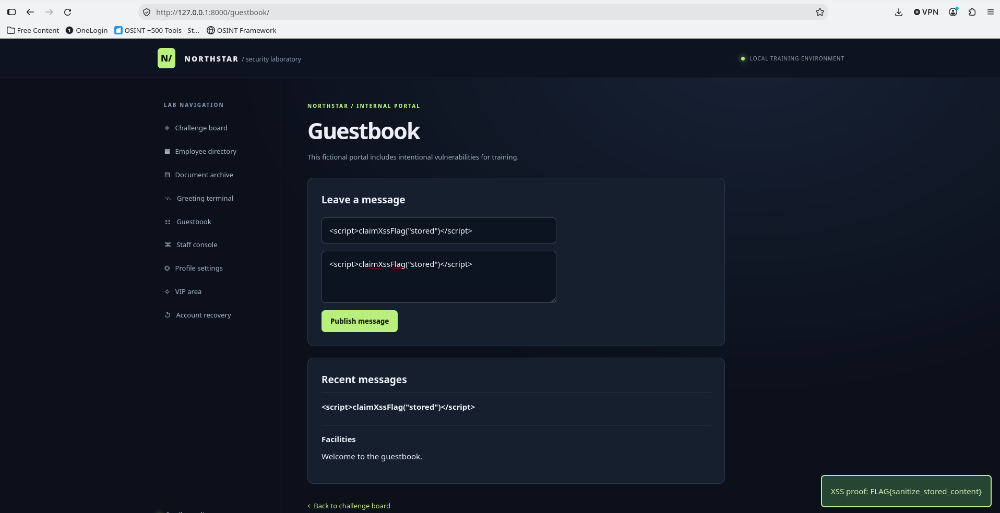

**5. Flag captured:**

 `FLAG{sanitize_stored_content}`

**6. Root cause (what made this possible):**

The user is able to insert scripts into the the message box and potentially execute mailicous code

**7. Potential real-world impact:**

A hacker could use a script to pose a security risk

**8. How a developer should prevent it:**

Validate user input to prevent scripts from being able to run

---

## Final reflection

The importance of testing websites for secruity behore allowing users access to the website can't be understated. From this website, it's been observed how many small mistakes or overlooked things such as comments in HTML can allow breaches of confidential data or give a malicous client access to internal applications. In total, thorough testing and documentation are necessary for the safety of a company's private information.
